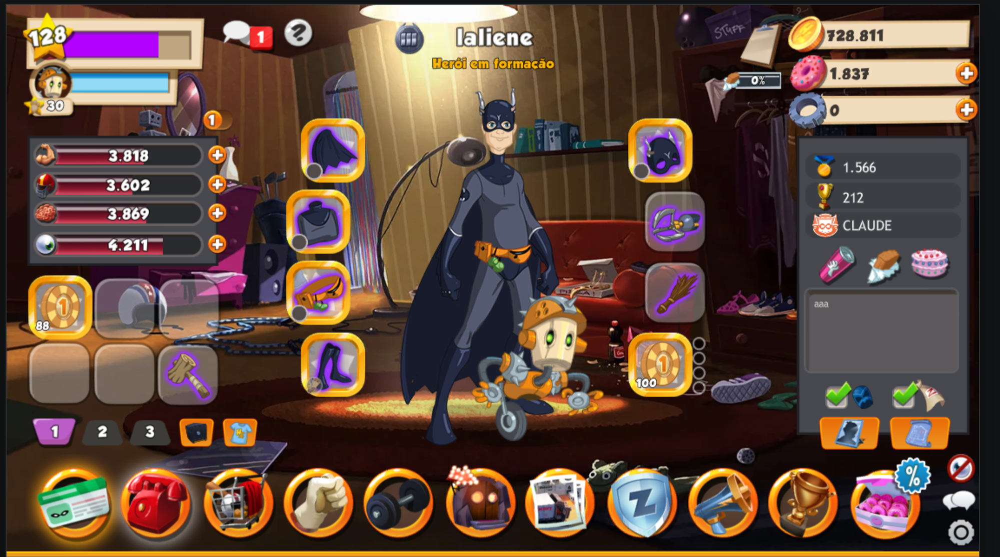

# 🦸 Hero Zero — Emulated Server (Reverse Engineering)

A reverse-engineering project of the game **Hero Zero** (Playata GmbH), building a
private server compatible with the official HTML5 client.

This is a fork of the [*original project*](https://github.com/ySKELLETONX/HeroZero_Server).

> ⚠️ For educational / private-server purposes only. The client and all game assets
> are property of Playata GmbH. No game assets are distributed in this repository.



## 📖 Overview

- 🎮 **Game server**: Laravel implementing the official HTTP protocol —
  `POST /request.php` with form-urlencoded actions, JSON `{ data, error }` envelope
  and `auth = md5(action + salt + user_id)` signature.
- ⚡ **Actions**: Most actions / game functions implemented, currently bullet proofing them.
- 🛠️ **Admin panel**: Currently bare-bones. Working on it.
- 🔌 **Real-time socket**: Node.js reimplementation of the official socket
  (Engine.IO v2 / Socket.IO v2) that pushes `syncGame`/`syncGameAndGuild` events
  (e.g. guild chat) to connected clients, with HTTP-polling fallback. Currently not working as intended.
### 🧰 Technologies

- 🐘 **PHP 8.4** + **Laravel 13** — game server and admin panel (Apache, `pdo_mysql`, APCu)
- 🟩 **Node.js 22** — real-time socket server (`ws`)
- 🐬 **MySQL 8.4** — database, with schema and seeds in `server-laravel/docker/initdb/`
- 🐳 **Docker / Docker Compose** — the whole stack runs in containers:

| Container | Image / build | Port (localhost) | Role |
|---|---|---|---|
| 🗄️ `db` | `mysql:8.4` | 3308 | Database |
| 🎮 `game` | `Dockerfile` (php:8.4-apache) | 8080 | Game server |
| 🛠️ `admin` | `Dockerfile` (php:8.4-apache) | 8001 | Admin panel |
| 🔌 `socket` | `Dockerfile.socket` (node:22-alpine) | 8090 | Real-time socket |

## 📁 Repository layout

```
HeroZero_Server/
├── server-laravel/        # Game server (Laravel)
│   ├── actions/           # One handler per client action (111 files)
│   ├── app/HeroZero/      # Game core: Router, Live, Character and game systems
│   ├── data/              # Response fixtures captured from the real game
│   ├── docker/initdb/     # MySQL schema and seeds
│   └── public/            # HTML5 client and served assets
├── admin-laravel/         # Admin panel (Laravel)
├── socket-server/         # Real-time socket server (Node.js, Engine.IO v2)
├── containers/            # Apache, PHP cache and entrypoint config for the PHP image
├── assets/                # Official game assets and constants (not published)
├── scripts/
│   ├── setup/             # Setup/reset scripts (tutorial player, casino, game clock, DB reset)
│   └── testing/           # Migrations, preparation scripts and tests
├── tools/                 # RE scripts (HAR extraction, fixture/schema generation)
├── docs/                  # Technical documentation and bug log
├── docker-compose.yml     # Stack definition (db, game, admin, socket)
├── Dockerfile             # PHP 8.4 + Apache image (game and admin)
├── Dockerfile.socket      # Node.js 22 image (socket)
├── start.sh               # Build and start the stack
├── stop.sh                # Stop the stack (data and volumes preserved)
└── reset_server.sh        # Destructive reset of all game data
```

## 🚀 Running

Requirements: Docker with Docker Compose.

```bash
bash start.sh
```

`start.sh`:

1. Builds and starts all containers (`docker compose up -d --build --wait`),
   using the current user's UID/GID inside the PHP containers.
2. Initialises the game clock in `.run/` on the first run.
3. Runs the setup scripts `ensure_tutorial_player.php` and `ensure_opening_casino.php`.

Once it's up:

- 🎮 Game: **http://127.0.0.1:8080/beta.html** (port configurable with `HZ_GAME_PORT`)
- 🛠️ Admin: http://127.0.0.1:8001
- 🔌 Socket: 8090 — 🐬 MySQL: 3308

💡 Keep the game tab focused — the client preloader uses `requestAnimationFrame`,
which browsers throttle in background tabs.

⚙️ Optional environment variables: `HZ_GAME_PORT`, `HZ_MYSQL_PASSWORD`, `HZ_SOCKET_TOKEN`.

```bash
docker compose logs -f     # follow logs
bash stop.sh               # stop the stack (data and volumes preserved)
bash reset_server.sh       # wipe all game data, no backup (see --help)
```

🧪 Test the API directly:

```bash
curl -X POST http://127.0.0.1:8080/request.php \
  -d "action=initEnvironment&user_id=0&auth=$(php -r 'echo md5("initEnvironmentGN1al3510");')"
```

## 📊 Status ( Whats (not) working)

<table>
  <tr><th>Category</th><th>Feature</th><th>Status</th><th>Notes</th></tr>
  <tr><td rowspan="5">👤 <b>Account</b></td><td>HTTP protocol &amp; login</td><td>✅ Working</td><td><code>initEnvironment → loginUser/autoLoginUser → initGame</code></td></tr>
  <tr><td>Registration &amp; character creation</td><td>✅ Working</td><td></td></tr>
  <tr><td>Name, description &amp; appearance</td><td>✅ Working</td><td>Needs testing / bulletproofing</td></tr>
  <tr><td>Settings &amp; tutorial</td><td>✅ Working</td><td></td></tr>
  <tr><td>Daily login &amp; bonus days</td><td>✅ Working</td><td>Unofficial values</td></tr>
  <tr><td rowspan="7">🦸 <b>Hero</b></td><td>Stats &amp; skill improvement</td><td>✅ Working</td><td></td></tr>
  <tr><td>Equipment</td><td>✅ Working</td><td></td></tr>
  <tr><td>Inventory &amp; bank</td><td>✅ Working</td><td></td></tr>
  <tr><td>Energy drinks &amp; boosters</td><td>✅ Working</td><td></td></tr>
  <tr><td>Item modifications &amp; gems</td><td>✅ Working</td><td>Value curve without an official formula</td></tr>
  <tr><td>Sidekicks</td><td>✅ Working</td><td>Needs bulletproofing</td></tr>
  <tr><td>Heroic deeds (goals)</td><td>❌ Not working</td><td>Crashes</td></tr>
  <tr><td rowspan="4">📜 <b>Quests</b></td><td>Quests &amp; quest energy</td><td>✅ Working</td><td>Formula approximated to the official server</td></tr>
  <tr><td>Story dungeons</td><td>✅ Working</td><td>Official XP curve</td></tr>
  <tr><td>Emergency calls</td><td>⚠️ Partial</td><td>Working, needs some fixes; rewards don't scale</td></tr>
  <tr><td>Special missions</td><td>❌ Not working</td><td>Being worked on, original game values still needed</td></tr>
  <tr><td rowspan="2">⚔️ <b>Fights</b></td><td>Duels</td><td>✅ Working</td><td>Coin rewards don't scale</td></tr>
  <tr><td>Leagues</td><td>✅ Working</td><td>Coin rewards don't scale</td></tr>
  <tr><td rowspan="1">🏋️ <b>Training</b></td><td>Training, training energy &amp; training quests</td><td>⚠️ Mostly working</td><td>Needs bulletproofing</td></tr>
  <tr><td rowspan="6">🏠 <b>Hideout</b></td><td>Unlock, build &amp; upgrade rooms</td><td>⚠️ Mostly working</td><td>Unlocking one specific location shows a broken image</td></tr>
  <tr><td>Place &amp; store rooms</td><td>⚠️ Mostly working</td><td>Not all rooms are implemented yet</td></tr>
  <tr><td>Room production &amp; resources</td><td>✅ Working</td><td></td></tr>
  <tr><td>Units</td><td>✅ Working</td><td></td></tr>
  <tr><td>Attacks &amp; defense</td><td>✅ Working</td><td></td></tr>
  <tr><td>Boosters</td><td>✅ Working</td><td></td></tr>
  <tr><td rowspan="9">🛡️ <b>Guild</b></td><td>Create, join &amp; leave</td><td>✅ Working</td><td></td></tr>
  <tr><td>Ranks &amp; positions</td><td>⚠️ Mostly working</td><td></td></tr>
  <tr><td>Guild chat</td><td>⚠️ Partial</td><td>Doesn't update in real time without the socket; needs changes</td></tr>
  <tr><td>Donations</td><td>✅ Working</td><td></td></tr>
  <tr><td>Guild battles (register attacks/defenses)</td><td>✅ Working</td><td></td></tr>
  <tr><td>Gang (NPC) attacks</td><td>✅ Working</td><td>Not confirmed whether rewards give energy, training or items</td></tr>
  <tr><td>Artifacts</td><td>✅ Working</td><td></td></tr>
  <tr><td>Watermelons</td><td>❌ Not working</td><td></td></tr>
  <tr><td>Guild trophies &amp; statistics</td><td>✅ Working</td><td></td></tr>
  <tr><td rowspan="5">🛒 <b>Shop</b></td><td>Thrift shop &amp; refresh</td><td>✅ Working</td><td>Items don't scale well</td></tr>
  <tr><td>World shop &amp; refresh</td><td>✅ Working</td><td>Items don't scale well</td></tr>
  <tr><td>Boosters</td><td>✅ Working</td><td></td></tr>
  <tr><td>Game store (local payments)</td><td>✅ Working</td><td>Local only, everything can be bought</td></tr>
  <tr><td>Vouchers</td><td>✅ Working</td><td></td></tr>
  <tr><td rowspan="6">🏆 <b>Rankings &amp; tournaments</b></td><td>Leaderboards</td><td>✅ Working</td><td></td></tr>
  <tr><td>Weekly tournament: XP</td><td>✅ Working</td><td>Needs bulletproofing / testing</td></tr>
  <tr><td>Weekly tournament: Skill points</td><td>✅ Working</td><td>Needs bulletproofing / testing</td></tr>
  <tr><td>Weekly tournament: PvP</td><td>✅ Working</td><td>Needs bulletproofing / testing</td></tr>
  <tr><td>HeroCon (team)</td><td>⚠️ Mostly working</td><td></td></tr>
  <tr><td>HeroCon (individual)</td><td>⚠️ Mostly working</td><td></td></tr>
  <tr><td rowspan="5">🎉 <b>Events</b></td><td>Seasons</td><td>⚠️ Mostly working</td><td>Needs some testing</td></tr>
  <tr><td>World boss</td><td>🧪 Needs testing</td><td>Scaling differs from the official one; rewards need to be closer to official</td></tr>
  <tr><td>Event quests, treasures &amp; draws</td><td>🧪 Needs testing</td><td></td></tr>
  <tr><td>Hero Academy (tower events)</td><td>🧪 Needs testing</td><td></td></tr>
  <tr><td>Casino</td><td>✅ Working</td><td>Official data for only one or two events</td></tr>
  <tr><td rowspan="3">⚙️ <b>Server</b></td><td>Game clock (<code>GameTime</code>)</td><td>✅ Working</td><td>Server day counter and debug time offset</td></tr>
  <tr><td>Admin panel</td><td>⚠️ Partial</td><td>Bare-bones</td></tr>
  <tr><td>Real-time socket</td><td>❌ Not working</td><td>Not working as intended</td></tr>
</table>

✅ Working · ⚠️ Partial / mostly working · 🧪 Needs testing · ❌ Not working
