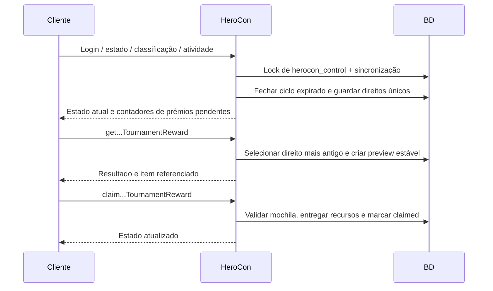

# HeroCons — funcionamento e implementação

Referência do estado implementado em 2026-10-07, para o cliente HTML5 `html5_257`.
Este documento descreve o código atual, incluindo regras locais e limitações.
O levantamento histórico do JavaScript e das constantes continua em
[herocon.md](../implementar/herocon.md); esse catálogo contém temas antigos e
não deve ser usado isoladamente como lista de HeroCons ativos.

## Fontes e responsabilidades

| Fonte | O que estabelece |
|---|---|
| `server-laravel/public/js/HeroZero.min.js` | Ações, campos, diálogos, fórmulas visuais de prémios e classificações |
| `assets/data/constants_json.data` e cópia pública | Identificadores, objetivos, pesos, faixas de habilidades, equipamentos e efeitos; JSON comprimido com zlib |
| `server-laravel/public/assets/i18n/pt_BR/text.data` | Descrição das caixas: grande com duas peças, pequena com uma, prioridade às peças em falta |
| Lista corrigida pelo utilizador | Temas ativos, pontos diretos, glória por combate, vendas com bónus dourado aditivo, exclusão de missões especiais |
| Backend local | Calendário, desempates, elegibilidade de equipa, duração do booster, persistência e entrega |

O cliente apresenta o estado e pede ações. O servidor valida a atividade,
calcula os pontos, guarda resultados e entrega os prémios. Não existe uma ação
pública para o cliente enviar uma quantidade arbitrária de pontos HeroCon.
As políticas locais não são apresentadas como fórmulas confirmadas do oficial.

## Classificações e participação

Uma competição semanal tem um tema global para o servidor e duas classificações:

- **Equipa:** `guild_competition`, tipo de torneio/prémio `5`.
- **Individual:** `solo_guild_competition`, tipo `6`.

No código atual, o herói precisa de pertencer a uma equipa **no momento da
atividade**, mesmo para pontuar na classificação individual. Sem equipa,
`HeroCon::record()` termina sem criar contribuição.

A contribuição fica associada ao ciclo, herói e equipa da altura. Mudar de equipa
não transfere nem elimina os pontos antigos. A classificação individual soma os
pontos do herói em todas as equipas desse ciclo. O contador apresentado entre os
membros da equipa mostra apenas a contribuição à equipa consultada.

## Os 13 temas ativos

A coluna «Identificador» omite o prefixo `default_guild_competition_`.
A ordem da tabela é a ordem atual da rotação, derivada da ordem do catálogo
após remover os temas desativados. Os tipos são enums dos objetivos do cliente,
não tipos de missão, equipamento ou recompensa.

| Ordem | HeroCon | Identificador | Pontuação e momento de contagem | Objetivos (`type`) |
|---:|---|---|---|---|
| 1 | Venda de itens | `sell_items` | Venda aceite: comum +1, raro +3, épico +9, lendário +27; borda dourada acrescenta +3 | 2, 3, 4, 32; bónus 12 |
| 2 | Missões concluídas | `quest_won` | +1 no resgate de uma missão normal bem-sucedida; derrota não conta | 18 |
| 3 | Energia consumida | `quest_energy_used` | +1 por ponto de energia efetivamente debitado ao iniciar uma missão normal | 19 |
| 4 | Compra de habilidades | `stat_points_bought` | +1 por ponto de atributo comprado com moedas; pontos gratuitos não contam | 17 |
| 5 | Glória do esconderijo | `collect_hideout_points` | +1 por ponto positivo de glória ganho num ataque ou defesa; não soma perdas | 1 |
| 6 | Missões de combate | `fight_quest_won` | Resgate de combate NPC em missão normal: vitória +3, derrota +1 | 20, 21 |
| 7 | Duelos | `duel_fought` | Resgate do duelo pelo atacante: vitória +3, derrota +1 | 11, 24 |
| 8 | Modificações de equipamento | `hideout_improvement_build` | Produzir/recolher ou aplicar: comum +3, rara +10, épica +20 | 26, 27, 28 |
| 9 | Energia em missões de tempo | `time_quest` | +1 por energia debitada ao iniciar missão normal de tempo (`quests.type=1`) | 6 |
| 10 | Ataques a vilões | `worldboss_attack` | +1 por combate efetivamente realizado ao fechar o ataque; +5 ao resgatar participação num vilão derrotado | 8, 9 |
| 11 | Níveis de acompanhantes | `sidekick_levelup` | +1 por nível efetivamente ganho; subir vários níveis conta o incremento completo | 29 |
| 12 | Exercícios de fitness | `training_missions` | +1 ao concluir/resgatar cada exercício de treino | 30 |
| 13 | Blocos de treino concluídos | `training_stars` | +1 ao reclamar a terceira estrela do bloco; as duas primeiras não pontuam | 31 |

Os pesos de venda lendária (+27) e modificação épica (+20) foram conservados das
constantes porque a lista corrigida não definiu outros valores para essas raridades.

### Precisões de contagem

- Só pontua o objetivo que corresponde ao **tema ativo**, não todos os temas
  compatíveis com a atividade. Uma missão pode emitir eventos de energia,
  conclusão e combate; o tema escolhe quais aceita.
- A energia conta ao iniciar. Cancelar depois não retira esses pontos. Repetir um
  início já aceite não volta a debitar energia nem a emitir pontuação.
- O bónus dourado na venda é aditivo: épico dourado = 9 + 3 = **12 pontos**.
  A marca de borda no protocolo é `ts_availability_start=15`.
- A glória é registada no fim de `startHideoutFight`, para atacante e defensor
  com delta positivo. Combates de tutorial não pontuam. A produção automática
  da sala de HeroCon e a produção de robôs não contam para este tema.
- No vilão, um ataque triplo conta os combates realizados, não simplesmente o
  número de pedidos. O +5 é emitido no resgate, com HP global a zero e pelo menos
  um combate realizado pelo participante. Estes eventos usam o HeroCon ativo
  **na altura do respetivo registo**, não uma competição guardada no vilão.
- Em modificações, a produção conta na recolha bem-sucedida da oficina; a
  aplicação conta depois de associar a melhoria ao equipamento. Produzir e
  aplicar a mesma melhoria são duas ações pontuáveis. Aplicação a acompanhantes
  não conta neste tema de equipamento.
- O tipo 31 mantém o nome histórico `trainingStarCollected`, mas o hook atual
  só é chamado na terceira estrela. A validação de disponibilidade dessa
  estrela pertence ao sistema de treinos, não ao HeroCon.
- Os hooks não são uma API de deduplicação por si próprios. A proteção contra
  pontuação duplicada depende da validação/transação da atividade de origem.

## Temas fora da rotação

`HeroCon::DISABLED` remove seis identificadores do catálogo bruto de 19 temas:

| Sufixo | Estado local |
|---|---|
| `complete_dungeon_quest` | Missões especiais: explicitamente excluídas do trabalho |
| `daily_herobook_completed` | Tema diário HeroBook antigo desativado |
| `hideout_bots_build` | Produção de robôs desativada |
| `collect_item_1` | Coleção antiga desativada |
| `collect_item_2` | Segunda coleção antiga desativada |
| `sell_items2` | Variante antiga de vendas; não é um segundo HeroCon ativo |

`record()` ignora também os tipos 5, 15, 22 e 25. As definições antigas continuam
nas constantes enviadas ao cliente para permitir referências históricas; isso
não as torna elegíveis para a rotação.

`questReward()` devolve uma lista vazia e `collectItem()` não pontua. Não há novos
colecionáveis HeroCon nas missões. `refreshOffers()` retira campos antigos de
ofertas ainda não iniciadas (`status=1`), com atualização condicional; não altera
missões em curso.

Se o ciclo ativo tiver um tema desativado, o servidor fecha-o preservando
contribuições/resultados e cria um tema válido. O código não apaga o histórico
nem reconstrói ações antigas com regras novas.

## Pontos, campos de frações e classificações

A regra local atual é **pontuação direta**:

```text
pontos acrescentados = quantidade × multiplier do objetivo
score = soma dos pontos
fraction = 0
```

Não se divide por `needed_fractions`. Por exemplo, 20 de energia dão 20 pontos,
não um ponto e uma barra de excedentes. `needed_fractions` continua nas
constantes porque pertence ao contrato e à barra antiga do cliente.

A coluna `herocon_contributions.fractions` conserva o nome histórico, mas guarda
**pontos diretos**. Não interpretar esse nome como uma conversão por limiar.
As versões antigas da documentação podem descrever a conversão abandonada.

`ranking()` soma por equipa ou personagem e ordena por:

1. Pontuação decrescente.
2. Timestamp de quando se atingiu essa pontuação, crescente.
3. ID do participante, crescente.

`herocon_rank_times` guarda os tempos separadamente para os tipos 5 e 6.
Participantes com zero pontos não entram na lista. O paginador devolve até 100
entradas em torno da posição escolhida. A pesquisa por nome é exata, ignorando
maiúsculas/minúsculas; não é pesquisa parcial.

## Calendário e relógio próprio

O tempo de referência é sempre `GameTime::now()`:

```text
GameTime = epoch inicial + uptime acumulado + offset de debug
```

O relógio só avança durante o funcionamento do servidor, além dos avanços
explícitos de debug. O calendário não usa a data real do computador para
substituir a data simulada. Avançar o relógio altera a semana HeroCon no pedido
seguinte que sincroniza o sistema.

**Configuração atual em `HeroCon::period()`:** quinta-feira às 21:00 até à quinta
seguinte às 21:00, interpretadas sobre o timestamp de jogo em `Europe/Lisbon`.
A âncora da rotação é 2026-10-01 às 21:00 nesse fuso. A mudança de hora usa dias
civis; uma semana de mudança de hora pode ter 167 ou 169 horas.

Há uma limitação explícita: este método fixa `Europe/Lisbon`; não consulta
`Live::gameTimezone()`, que lê `HZ_GAME_TZ`. Se o fuso configurado do jogo mudar,
os dois calendários podem divergir. O relógio interno e o fuso são conceitos
separados: usar Lisboa aqui não significa usar a hora real de Lisboa.

O processamento é lazy, sem cron: `sync()`/`cycle()` fecham ciclos expirados e
abrem o período atual no primeiro pedido relevante. Saltar várias semanas não
cria competições vazias para cada semana intermédia. Um ciclo existente válido
é mantido até ao seu fim; alterar o relógio não reescreve todas as datas guardadas.

## Prémios individuais

`soloStats()` lê as faixas das constantes:

| Posição | Pontos de habilidade |
|---|---:|
| 1–3 | 10 |
| 4–10 | 9 |
| 11–20 | 8 |
| 21–30 | 7 |
| 31–40 | 6 |
| 41–50 | 5 |
| 51–100 | 4 |
| 101–150 | 3 |
| 151–200 | 2 |
| 201–300 | 1 |
| Acima de 300 | 0 |

O primeiro recebe também `surprise_box_solo_herocon_big_1`; as posições 2–5
recebem `surprise_box_solo_herocon_small_1`. O primeiro não recebe ambas.
Todos os participantes com pontuação positiva têm um resultado individual,
mesmo quando a posição não concede recursos.

### Temporadas

No fecho, `entitle()` consulta o progresso de temporada existente. Se estiver
ativo (`status=2`) e o fim do ciclo estiver dentro dessa temporada, guarda os
pontos definidos nas localizações 3 (top 3), 4 (top 10) ou 5 (top 100).
Os valores dependem da temporada, não são um número fixo neste módulo.

No resgate, esses pontos só são entregues se a mesma temporada continuar ativa.
Não passam para uma temporada diferente. Os pontos de habilidade e a caixa
continuam a ter o seu direito de resgate independente dessa expiração.

## Prémios de equipa e booster

Para prémios positivos, a equipa precisa de pelo menos **100 pontos** e posição
até **100**. `guilds_with_rewards` conta as equipas que cumprem ambos os critérios.
Resultados de equipas que pontuaram mas não cumprem esses limites podem ser
consultados/resgatados, sem conceder recursos.

A fórmula partilhada com a apresentação do cliente é:

```text
fator = max(1 - rank / guilds_with_rewards × 1.1,
            0.05,
            1.625 - 0.15 × rank)
booster_percentagem = ceil(fator × 20)
pontos_habilidade = ceil(fator × 24)
```

Com 100 equipas elegíveis: primeiro lugar dá booster de 30% e 36 pontos de
habilidade; centésimo dá 1% e 2 pontos. `teamReward()` devolve zero se a posição
ou o denominador forem inválidos.

Os pontos de habilidade de equipa só têm direito para heróis que contribuíram
nessa equipa e continuam nela no fecho. Sair depois do fecho não elimina o direito.

O booster é aplicado **automaticamente no fecho**, na equipa, e não no resgate
individual. Expira no fim do período seguinte, não soma percentagens a boosters
HeroCon anteriores. Se o fecho só for processado muito tarde, parte ou toda a
validade já pode ter decorrido.

`boost()` devolve `1 + percentagem/100` enquanto válido. `Character` aplica esse
fator a XP e moedas das missões normais **quando gera a oferta**, arredondando
os valores. Não altera ofertas/prémios já fixados. Não há aplicação HeroCon ao
trabalho ou aos prémios de vilão nesta implementação.

## Fecho, preview e resgate



`finish()` calcula as duas classificações; `entitle()` grava um direito único por
ciclo/personagem/tipo. Resultados pendentes são entregues do mais antigo para o
mais recente e não têm expiração geral implementada.

`reward()` cria a caixa de preview uma única vez em `items`, sem a colocar logo
na mochila. `assertItemsAvailable()` impede usar/mover/vender esse preview
através dos fluxos protegidos antes de resgatar o direito.

O resgate usa locks e transação; valida espaço entre os 6/12/18 slots desbloqueados.
Mochila cheia devolve `errInventoryNoEmptySlot` e reverte a entrega. No resgate
individual, `discard_item=true` elimina só a caixa e mantém habilidades/temporada.
Um segundo resgate não entrega recursos novamente.

Os feitos são incrementados no resgate, não apenas no fecho. `viewed()` conta a
visita uma vez por ciclo e retira o aviso de nova competição.

## Abertura das caixas

`useInventoryItem` encaminha as duas caixas para `HeroConBox::open()`.
Não depende de uma ação nova nem de alteração do bundle JavaScript.

| Caixa | Conteúdo |
|---|---|
| Grande | Duas peças épicas do `solo_herocon_set` |
| Pequena | Uma peça épica do `solo_herocon_set` |

O conjunto tem máscara, capa, fato, cinto e botas. A seleção é uniforme entre as
peças elegíveis, como política local. Prioriza peças em falta considerando todos
os itens que o herói ainda possui e marcadores persistidos em `goal_stats` com o
prefixo `herocon_box_collected_`. A forma com efeito conta como a mesma peça.

Dentro da caixa grande, a primeira peça passa imediatamente a ser considerada
obtida antes do segundo sorteio. Quando o conjunto já está completo, a seleção
volta ao conjunto inteiro; repetições são possíveis. O histórico não reconstrói
peças vendidas antes desta implementação nem substitui um sistema geral de
coleções/costura.

Cada peça tem **20%** de hipótese de sufixo `-effect-shc`, conforme os templates.
O acompanhante Orion tem referências de origem em caixas, mas a sua probabilidade
não foi confirmada; não está no sorteio atual.

### Atributos, borda e modificação

`HeroConBox` chama `Character::createEventRewardItem()`, que usa
`createWorldbossRewardItem()` e a mesma função `shopItemStats()` usada pela loja.
Para estas peças:

```text
nível_item = max(1, nível_herói - aleatório(0..4))
qualidade = 3 (épico)
budget = ceil((nível_item × 1.6 + 2 + nível_item² × 0.004) × 2.3)
         + bónus_plano_kybernetic_do_esconderijo
```

O budget distribui-se pelos quatro atributos: três atributos em 40% dos sorteios,
quatro em 60%, conforme o gerador da loja. A venda usa metade do preço calculado
da loja, com mínimo 4. Os atributos não são apresentados como fórmula oficial:
é a fórmula local já usada pelo brechó.

Todos os novos itens destas caixas vêm com:

- Borda dourada: `ts_availability_start=15`.
- Espaço de modificação gratuito e vazio: `ts_availability_end=1`.
- Sem custo de compra: são prémios.

Uma melhoria aplicada transforma `ts_availability_end` em `-ID_da_melhoria`,
conforme o sistema de [modificações](../shop_items/modificacoes.md).

### Capacidade, atomicidade e resposta visual

A abertura valida dono, identificador, tipo 10, nível e presença da caixa na
mochila desbloqueada. Locks de personagem/inventário/item e savepoint protegem a
entrega. A caixa só é consumida na mesma transação que cria e coloca os prémios.

O slot da caixa fica disponível quando é consumida: a pequena pode abrir com a
mochila cheia; a grande de uso único precisa de mais um espaço. Se não houver
capacidade, a caixa permanece. `charges=0` nas caixas antigas significa uso único;
com várias cargas, a caixa permanece até à última e o espaço não é reutilizado
antes disso. Repetir a abertura de uma caixa já consumida não volta a dar prémios.

O cliente abre `DialogSurpriseBoxContent` e lê até três entradas da coleção
`items`. Por isso, **na resposta final da abertura**, `items` contém exatamente
os um/dois prémios; não a lista inteira do inventário. Os objetos anteriores já
estão carregados no cliente. As outras coleções de estado continuam presentes.

O handler usa o marcador interno `_herocon_box_reward_ids`. `Router::dispatch()`
filtra `items` **depois** dos sistemas de eventos que podem reconstruir a coleção
e remove o marcador antes de responder. Filtrar só no handler não basta.
O bug de mostrar sempre equipamentos antigos está registado como
[BUG-000167](../bugs_encontrados.md#bug-000167-2026-10-07--caixas-solo-herocon-rejeitadas-ao-abrir).

## Contrato HTTP e ações

O transporte é o protocolo habitual `POST /request.php`, com autenticação/sessão
validadas pelo servidor e envelope `{ "data": {...}, "error": "" }` em sucesso.
Os parâmetros abaixo são adicionais aos campos comuns; ver [PROTOCOL.md](../PROTOCOL.md).

| Ação | Parâmetros específicos | Resultado principal |
|---|---|---|
| `retrieveGuildCompetitionTournamentLeaderboard` | Opcionais `rank` ou `guild_name` | `leaderboard_guild_competitions`, `max_guild_competitions`, posição centrada, fim |
| `retrieveSoloGuildCompetitionTournamentLeaderboard` | Opcionais `rank` ou `character_name` | `leaderboard_solo_guild_competitions`, `max_solo_guild_competitions`, posição centrada, fim |
| `retrieveGuildCompetitionTournamentLeaderboardGuildsAroundOwnGuild` | Nenhum | Estado atualizado com vizinhos em `guild_competition_data`; não cria uma lista independente |
| `getGuildCompetitionTournamentReward` | Nenhum | `tournament_guild_competition_reward` do direito mais antigo de tipo 5 |
| `getSoloGuildCompetitionTournamentReward` | Nenhum | `tournament_solo_guild_competition_reward` do direito mais antigo de tipo 6 |
| `claimGuildCompetitionTournamentReward` | Nenhum | Resgate e estado atualizado |
| `claimSoloGuildCompetitionTournamentReward` | Opcional `discard_item` booleano | Resgate individual e estado atualizado |
| `setNewGuildCompetitionViewed` | Nenhum | Marca o ciclo como visto e atualiza o estado |
| `useInventoryItem` | `item_id` da caixa | Entrega e `items` limitado aos prémios da abertura |

As oito ações específicas passam por `actions/herocon.php`; a abertura passa por
`actions/inventoryOps.php`. A ação «around own guild» não tem lógica própria no
switch: o estado enriquecido por `attach()` fornece os vizinhos.

### Estado enviado ao cliente

`HeroCon::attach()` é usado no login, `Live::accountState()` e respostas parciais
próprias do herói através do Router. `Live::template()` injeta as constantes
HeroCon. Sem migração disponível, `attach()` conserva o estado recebido e não
ativa o sistema.

| Campo | Tipo e significado |
|---|---|
| `guild_competition_tournament_end_timestamp` | Inteiro, timestamp de jogo do fim atual |
| `current_guild_competition_identifier` | String, tema da equipa; enviado apenas com equipa |
| `guild_competition_data` | Objeto do ciclo atual; enviado apenas com equipa |
| `next_guild_competition_data` | Objeto do próximo período, `status=0`; apenas com equipa |
| `character.guild_competition_points_gathered` | Inteiro, contribuição à equipa atual |
| `character.guild_competition_point_fractions_gathered` | Inteiro, zero nesta implementação |
| `character.pending_guild_competition_tournament_rewards` | Inteiro, quantidade de direitos de equipa pendentes |
| `character.pending_solo_guild_competition_tournament_rewards` | Inteiro, quantidade de direitos individuais pendentes |
| `character.new_guild_competition_tournament` | Booleano, ciclo atual ainda não marcado como visto |
| `current_goal_values` | Contadores dos feitos HeroCon, com `value` e `current_value` |
| Campos do booster em `guild`/`requested_guild` | Inteiros: fator percentual e timestamp de expiração |

O objeto atual contém `identifier`, `status=1`, `ts_start`, `ts_end`, `rank`,
`score`, `fraction`, `guilds_with_rewards`, `guilds_same_score`,
`guilds_higher_score` e `guilds_lower_score`. Sem pontuação, a posição própria é
zero. Um vizinho pode ser `null`; quando existe, inclui pontuação, número de
equipas empatadas, nome e campos do emblema.

Nas listas, cada entrada inclui `rank`, `id`, `n` (nome), `s` (pontos) e os campos
compactos de emblema `ebs`, `ebc`, `ebbc`, `eis`, `eic`, `eiz`.
A lista individual acrescenta `r` (posição esperada por esse componente), `g`
(género), `os` (1 se ação há menos de 300 segundos de jogo, senão 2), `gi` e `gn`.
Não remover `r` por parecer duplicado de `rank`: os componentes leem campos diferentes.

### Resultado e JSON aninhado

O objeto `tournament_*_reward` tem `identifier` e `rewards`. `rewards` é uma
**string JSON**, cujo campo `reward` é também uma **string JSON**:

```json
{
  "identifier": "default_guild_competition_sell_items",
  "rewards": "{\"rank\":1,\"value\":3000,\"reward\":\"{\\\"statPoints\\\":10,\\\"item\\\":123}\"}"
}
```

O exemplo tem um ID ilustrativo. Para construir as strings no backend,
encadear `json_encode`, como `reward()` faz:

```php
$reward = ['statPoints' => 10, 'item' => 123];
$rewards = json_encode([
    'rank' => 1,
    'value' => 3000,
    'reward' => json_encode($reward, JSON_THROW_ON_ERROR),
], JSON_THROW_ON_ERROR);
```

O ID de caixa referenciado precisa de existir na coleção de itens enviada para
o cliente antes de desenhar o preview. Não substituir strings aninhadas por
objetos JSON, nem enviar itens só por ID sem os dados necessários.

### Erros relevantes

| Erro | Situação |
|---|---|
| `errTournamentLocked` | Tabelas HeroCon indisponíveis numa ação que exige o sistema |
| `errRetrieveLeaderboardInvalidRank` | Posição pedida fora da lista |
| `errRetrieveLeaderboardInvalidCharacter` | Nome individual não encontrado |
| `errRetrieveLeaderboardInvalidGuild` | Equipa não encontrada |
| `errClaimGuildCompetitionTournamentRewardsNoRewards` | Sem direito de equipa pendente / retry após resgate |
| `errClaimSoloGuildCompetitionTournamentRewardsNoRewards` | Sem direito individual pendente / retry após resgate |
| `errInventoryNoEmptySlot` | Sem espaço suficiente para entrega ou abertura |
| `errInventoryInvalidItem` | Preview ainda não resgatado, caixa inválida, de outro dono ou fora da mochila |
| `errUseItemItemReqLevel` | Herói abaixo do nível exigido para abrir |

Preservar os códigos exatos: o cliente mostra mensagens específicas para nível
e mochila cheia. A ausência de uma caixa já consumida é validada em
`HeroConBox::open()`; o handler genérico pode devolver estado sem ação se o ID
nem sequer existir, mas não entrega prémios nesse retry.

## Funções e integração no código

| Ficheiro / função | Responsabilidade |
|---|---|
| `HeroCon::available()` | Verifica existência de `herocon_rewards`; não substitui uma migração completa |
| `HeroCon::constants()` / `themes()` | Carregamento zlib/cache e filtro da rotação |
| `HeroCon::period()` | Datas e índice do tema semanal |
| `HeroCon::sync()` / `cycle()` | Lock global, fecho e criação do ciclo |
| `HeroCon::record()` | Valida equipa, objetivo/reference, peso e persiste contribuição |
| `HeroCon::sold()` | Emite raridade e bónus dourado aditivo |
| `HeroCon::points()` / `contribution()` | Pontos diretos e contador por herói/equipa |
| `HeroCon::ranking()` / `leaderboard()` / `neighbour()` | Soma, ordenação, página e vizinhos |
| `HeroCon::finish()` / `entitle()` | Snapshot de resultados, direitos, temporada e booster |
| `HeroCon::soloStats()` / `teamReward()` | Fórmulas/faixas de prémios |
| `HeroCon::reward()` | Preview estável e entrega única |
| `HeroCon::viewed()` | Aviso de competição e feito de visita |
| `HeroCon::attach()` / `refreshOffers()` | Estado do protocolo, contadores, booster e limpeza de colecionáveis antigos |
| `HeroCon::assertItemsAvailable()` | Proteção dos previews pendentes |
| `HeroCon::boost()` | Fator aplicado na geração de missões |
| `HeroConBox::open()` | Sorteio, criação e colocação atómica das peças |
| `Character::createEventRewardItem()` / `shopItemStats()` | Equipamento épico, fórmula da loja, borda e espaço |
| `Live::template()` / `accountState()` / `guildMembers()` | Constantes, estado e contribuição nos membros |
| `actions/autoLoginUser.php` | Integração no login após montagem do estado |
| `Router::dispatch()` | Enriquecimento de respostas próprias e filtro final da abertura |

Os métodos internos `cycle`, `finish`, `entitle`, `refreshOffers` e `neighbour`
são privados. Os restantes da tabela pertencem à API interna do backend; não
são automaticamente ações públicas de `request.php`.

### Produtores reais de pontos

| Origem | Função/fluxo |
|---|---|
| Missões normais | `Character::startQuest()` e `claimQuestRewards()` |
| Duelos | `actions/claimDuelRewards.php` |
| Treinos | `Character::claimTrainingQuestRewards()` e `claimTrainingStar()` |
| Atributos | `Character::improveStat()` |
| Vendas | `inventoryOps.php`, `sellInventoryItems.php`, `Missiles::operate()` |
| Vilões | `Worldboss::action()`: fecho de ataque e resgate do evento |
| Níveis de acompanhantes | `Sidekick::refreshLevelAndStats()` |
| Produção de modificações | `actions/hideoutExtra.php`: recolha da oficina |
| Aplicação de modificações | `ItemImprovement::useItem()` apenas em equipamento |
| Glória | `actions/hideoutExtra.php`: resolução de combate real |

`record()` compara também `reference`: referência vazia aceita qualquer uma;
`all` é genérica; uma lista separada por `;` aceita os valores indicados.
Os temas ativos atuais usam referências vazias.

## Persistência, migração e transações

| Tabela | Dados principais / proteção |
|---|---|
| `herocon_control` | Linha id=1, lock comum para ciclo, fecho e pontuação |
| `herocon_cycles` | Tema, início, fim, `finished`; início único |
| `herocon_contributions` | Pontos em `fractions`, timestamp; chave ciclo/herói/equipa |
| `herocon_rank_times` | Tempo por ciclo/tipo/participante para desempatar |
| `herocon_views` | Último ciclo visto por personagem |
| `herocon_rewards` | Snapshot, habilidades, caixa/preview, temporada, `claimed`; direito único ciclo/herói/tipo |

Outros dados: campos do booster na tabela `guild`, caixas e peças em `items`,
slots em `inventory`, histórico de peças e feitos em `character.goal_stats`.

Schema inicial: `server-laravel/docker/initdb/15_herocon.sql`. Para uma BD já
existente, executar explicitamente:

```bash
php scripts/testing/migrate_herocon.php
```

A migração é idempotente, cria as tabelas e acrescenta os dois campos de booster
se faltarem. É uma operação persistente; não deve correr dentro de uma transação
de jogo. Alterar só o initdb não atualiza uma instalação existente.

O sistema usa `StoryDungeon::transaction()` para atividades de personagem e
`Missiles::transaction()` na sincronização. Ambos respeitam transações exteriores
com savepoints. Resgate e abertura não devem ser separados da entrega de recursos
ou da marcação de consumo. A chave única dos direitos e o estado `claimed`
protegem o fecho/resgate repetidos.

## Testes e limites da validação

```bash
php scripts/testing/test_herocon.php
node scripts/testing/test_herocon_client.js
php scripts/testing/test_herocon.php --mysql --hero="Nome do herói"
```

O primeiro testa catálogo, exclusões, pontos diretos, calendário e faixas de
prémios offline. O JavaScript compara 300 combinações de prémios de equipa e
301 posições individuais com as fórmulas reais do cliente.

O modo MySQL prepara equipa/ciclo/recursos temporariamente e faz rollback.
É preciso uma BD migrada e uma equipa existente para clonar. Evitar jogar com
o herói escolhido enquanto o teste decorre. Sem `--hero`, usa a primeira conta.

Cobertura MySQL: objetivos dos 13 temas, compra paga de atributos, início/retry
real de missão, venda dourada aditiva, classificação, fecho repetido, previews,
mochila cheia, descarte, resgate único, booster, visita, substituição de tema
retirado, abertura grande/pequena, histórico de peças e fórmula/borda/espaço.
A abertura é verificada pelo Router, incluindo a lista final com exatamente dois
ou um itens e remoção do marcador interno.

Regressões relacionadas já executadas: geração de missões offline/PDO simulado,
modificações de acompanhantes e recolha da oficina com rollback. Testar objetivos
por `record()` não prova todos os produtores reais. A glória em combate e o bloco
inteiro de treino precisam de confirmação dedicada/manual. Confirmação visual
da correção de `a.png` e teste de concorrência com processos simultâneos não
estão registados como concluídos.

## Limitações e manutenção

- Missões especiais ficam excluídas; não acrescentar o tema sem implementar e
  validar a funcionalidade de origem.
- Fuso HeroCon fixo em Lisboa: documentado acima; ainda não segue `HZ_GAME_TZ`.
- A barra de frações do cliente mantém o contrato antigo, com `fraction=0`;
  a classificação funciona em pontos diretos.
- A seleção de aparências, entrega geral de feitos/títulos e coleção/costura
  completa não são implementadas pelo módulo HeroCon.
- Orion não entra no conteúdo enquanto não houver regra/probabilidade confirmada.
- Alterações de pontuação não reconstroem eventos passados nem reescrevem direitos
  de prémio já preparados.
- Prémios pendentes acumulam-se; não existe política de expiração geral.
- Acrescentar um tema exige catálogo, produtor real, momento de contagem,
  atomicidade, protocolo, teste e atualização desta referência. Não basta
  remover o identificador de `DISABLED`.

## Documentos relacionados

- [Levantamento histórico HeroCon](../implementar/herocon.md)
- [Estado de funcionalidades](../Features.md)
- [Protocolo HTTP](../PROTOCOL.md) e [schema de respostas](../RESPONSE_SCHEMA.md)
- [Guildas](../Guilda/README.md)
- [Geração de itens](../shop_items/geracao_itens.md) e [modificações](../shop_items/modificacoes.md)
- [Treinos](../treinos/implementacao.md)
- [Vilões/worldboss](../vilao%20-%20worldboss/worldboss.md)
- [Bugs encontrados](../bugs_encontrados.md), sobretudo BUG-000167
